# Chatbot test log: complete answers

Generated by `node tests/test_log.js` on 2026-11-16 from the code in this repo (the same code as the live site).
Each entry shows what was typed, what a correct answer needs, and the chatbot's **complete answer, word for word**,
followed by a screenshot. Nothing is summarized. Source tags like [S11] are links in the page; the "Sources" list
under each answer names them.

Contents: A. the five Part 1 sample questions, plus the "half of a double" question the Part 1 bot couldn't answer ·
B. the ten Part 2 property questions, checked against the raw roll · C. the demo conversation (general question,
lookup, the layers together, refusal).

## A. General questions (Part 1 sample questions, re-run)

### A1. "How is my property tax bill calculated?"

**A correct answer needs:** Formula; $300,000 example with 121.20 citywide mills + levee; police/fire mills without homestead; sources.

**Complete answer:**

> How your property tax bill is calculated (worked example)
> 
> Tax = (assessed value − exemptions) × millage ÷ 1,000, added up across every millage that applies to the property [S11].
> 
> The City's 2026 table lists 121.20 mills citywide. Levee district millage is added on top: 10.79 mills on the East Bank, 10.81 in Algiers [S11]. Example: a $300,000 home on the East Bank with a homestead exemption, 2026 rates.
> 
> Step	Math	Result
> Fair market value	set by Assessor	$300,000
> × 10% residential ratio	$300,000 × 0.10	$30,000 assessed
> − Homestead exemption	$30,000 − $7,500	$22,500 taxable
> × 121.20 citywide mills	$22,500 × 0.12120	$2,727.00
> + police & fire mills that get no homestead reduction (11.51)	$7,500 × 0.01151	$86.33
> Citywide subtotal		$2,813.33
> + East Bank levee district (10.79)	$22,500 × 0.01079	$242.78
> Total, East Bank (131.99 mills)		$3,056.10 / year
> Same home, no homestead	$30,000 × 0.13199	$3,959.70 / year
> 
> What homestead saves here: $903.60 a year ($822.68 of it on the citywide millages). That's less than $7,500 × the full rate, because the 11.51 police and fire mills "without applying homestead exemption" are charged on the whole assessed value [S11][S30].
> 
> Sources: ratio [S1], homestead amount [S2], rates [S11]. The state roll files show the same totals on every parcel: 131.99 mills on the East Bank and 132.01 in Algiers [S30]. Line amounts are rounded to the cent.
> 
> Not included: special districts. The Downtown Development District adds 13.73 mills, some security districts add about 7 mills, and others charge flat fees, mostly a few hundred dollars a year [S11]. Find your property above to see its own recorded tax.
> 
> SOURCES
> S11 City of New Orleans Treasury — Millages: How Taxes are Calculated (2026 millage table: 121.20 mills citywide)
> S30 Louisiana Tax Commission — Orleans 2026 tax roll files, incl. millage by parcel (posted Nov. 2025)
> S1 La. Const. Art. VII §18 (ratios, reappraisal every four years, phase-in, special assessment level)
> S2 La. Const. Art. VII §20 (homestead exemption)
> 
> Want your own numbers? Find your property in the box above (address or parcel ID). I'll answer this question for it as soon as you pick it.

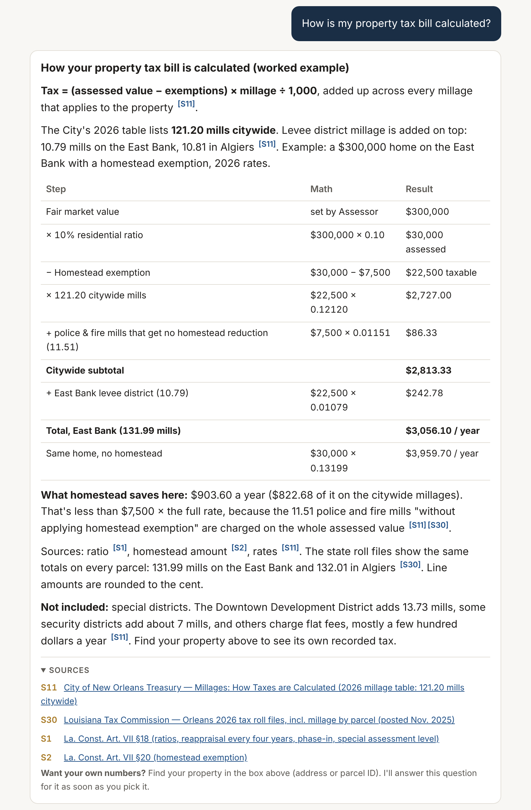

### A2. "How do I apply for the homestead exemption?"

**A correct answer needs:** Amount, own-and-occupy rule, documents, a note that the instructions are dated and should be confirmed; contacts.

**Complete answer:**

> How to apply for the homestead exemption
> 
> The homestead exemption takes $7,500 off your assessed value, which equals the first $75,000 of market value. It applies only to the home you own and live in, and you must own and occupy it by December 31 of the year you claim it [S2][S3]. A person or married couple can have only one [S2].
> 
> How to apply: you apply with the Orleans Parish Assessor's Office, City Hall, 1300 Perdido St., Room 4E01 [S9]. The Assessor's application form and flyer ask for [S8][S9]:
> 
> Proof of ownership: act of sale or deed
> A Louisiana driver's license or state ID showing the property address
> A current Entergy (or cable) bill for the property, with matching name, service address and mailing address
> 
> Those documents say every owner who lives in the home applies in person, and that a mailing address different from the property needs a recorded power of attorney [S8][S9]. They date from 2021 and 2024, and I can't check the Assessor's website myself, so please confirm the current steps (including whether you can apply online or by appointment) at nolaassessor.com or by phone before you go.
> 
> What it saves: about $903.60 a year on the East Bank at 2026 rates ($7,500 × 120.48 mills). It lowers most of your bill but not all of it: the police and fire millages "without applying homestead exemption" (11.51 of the 131.99 mills) are charged on your full assessed value [S11][S30].
> 
> SOURCES
> S2 La. Const. Art. VII §20 (homestead exemption)
> S3 La. R.S. 47:1703 (homestead statute)
> S9 Orleans Parish Assessor — Homestead Exemption application
> S8 Orleans Parish Assessor — Homestead flyer: Once Gained, Permanently Applied
> S11 City of New Orleans Treasury — Millages: How Taxes are Calculated (2026 millage table: 121.20 mills citywide)
> S30 Louisiana Tax Commission — Orleans 2026 tax roll files, incl. millage by parcel (posted Nov. 2025)
> Talk to a person:
> Orleans Parish Assessor's Office, City Hall, 1300 Perdido St., Room 4E01. Appraiser appointments: (504) 754-8811. nolaassessor.com
> Board of Review (City Council): council.nola.gov
> Tax bills and payments: nola.gov/property-tax
> Free legal help: Southeast Louisiana Legal Services, slls.org
> Prepare a note to hand this to a person

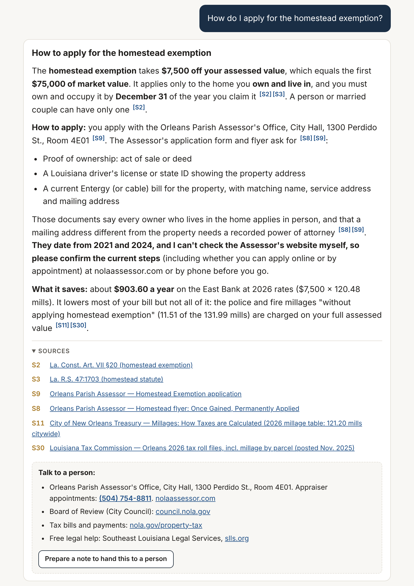

### A3. "What does the 2027 reassessment mean for me?"

**A correct answer needs:** 2024–27 values as of Jan. 1, 2023 (official); the 2027 roll is not a reappraisal; next one inferred for 2028; appeal status for today.

**Complete answer:**

> What the 2027 reassessment is
> 
> What's established: Louisiana reappraises all property on a four-year cycle [S1]. Tax year 2024 was a reappraisal year. The Legislative Auditor's report says property is valued as of Jan. 1, 2023 "for tax years 2024 through 2027" [S15], and the City Council said the same in 2023 [S32].
> 
> So the 2027 roll is not a new reappraisal. It was open for inspection July 15 – Aug. 17, 2026 [S4], and the copy the Assessor filed with the state keeps 98% of values the same as 2026, every one still dated 01/01/2023 [S31]. Between reappraisals the Assessor can still change a value for a sale, construction, demolition, damage or remodeling [S15].
> 
> What comes next: the four-year pattern (2020, 2024) points to tax year 2028 as the next reappraisal year, with property valued as of Jan. 1, 2027. That means the reappraisal work happens during 2027 and the new values appear on the 2028 roll, posted in summer 2027. I'm inferring that from the cycle [S15][S1]; I haven't found an official announcement, so please confirm with the Assessor's Office.
> 
> Will the 2027 bills go up? Mostly yes, a little, but from rates, not values: the East Bank levee millage rises from 10.79 to 12.28 [S31], and on Nov. 5, 2026 the City Council approved a partial roll-forward of 4.039 mills on top [S33].
> 
> What it means for owners: (1) your value may change in the next reappraisal even if you change nothing; (2) in a reappraisal year each millage is rolled back so it raises the same total, though taxing bodies can vote to roll forward [S15]; (3) the open-roll period in summer 2027 is the time to check a new value and appeal if you disagree; (4) make sure your homestead or freeze is on file before then. Status: the appeal window for the 2027 roll closed at 4 p.m. on Thursday, Aug. 20, 2026 [S4]. The next window, for the 2028 roll, should open in summer 2027 (it usually runs mid-July to mid-August) [S4][S5]. The exact dates haven't been announced, so I don't know them yet.
> 
> SOURCES
> S1 La. Const. Art. VII §18 (ratios, reappraisal every four years, phase-in, special assessment level)
> S15 La. Legislative Auditor — Tax Year 2024 Quadrennial Reappraisal, Orleans Parish Assessor (Dec. 2023)
> S32 New Orleans City Council — Councilmember Green on assessments vs. taxes: 2024–27 values as of Jan. 1, 2023 (July 2023)
> S4 Orleans Parish Assessor — 2027 Assessment Rolls Open July 15 to Aug. 17 (July 13, 2026)
> S31 Louisiana Tax Commission — Orleans 2027 tax roll files (filed Sept. 4, 2026)
> S33 Fox 8 — City Council approves millage roll-forward (Nov. 5, 2026) secondary
> S5 Orleans Parish Assessor — 2026 Assessment Rolls Open July 15 to Aug. 15 (July 14, 2025)
> Talk to a person:
> Orleans Parish Assessor's Office, City Hall, 1300 Perdido St., Room 4E01. Appraiser appointments: (504) 754-8811. nolaassessor.com
> Board of Review (City Council): council.nola.gov
> Tax bills and payments: nola.gov/property-tax
> Free legal help: Southeast Louisiana Legal Services, slls.org
> Prepare a note to hand this to a person

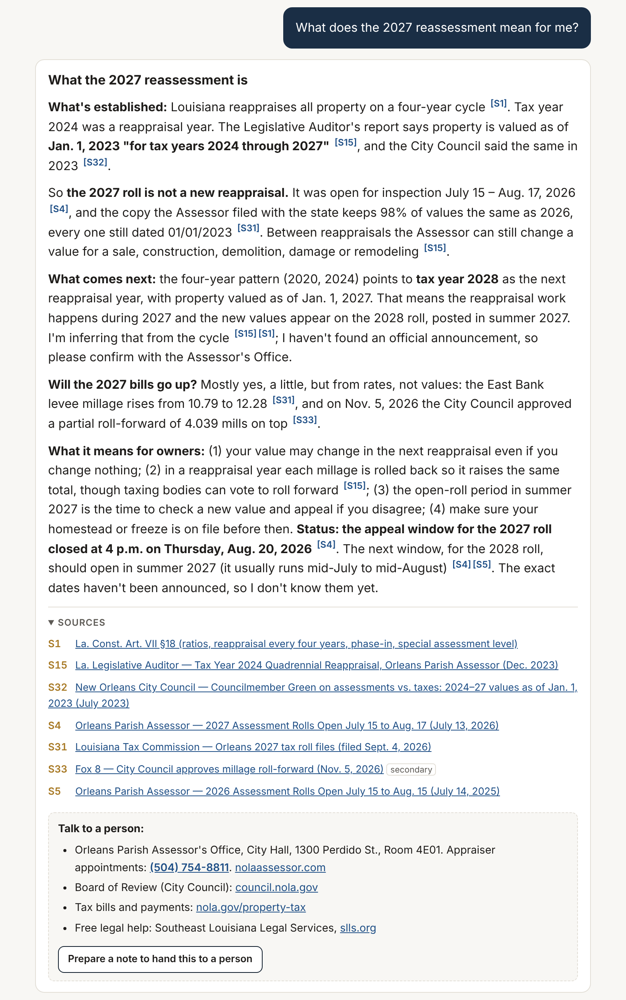

### A4. "Should I appeal? My house is worth less than what the Assessor says."

**A correct answer needs:** Refuses advice, then gives the appeal steps, today's deadline status and human contacts.

**Complete answer:**

> That's a decision for you, and I can't give legal or tax advice. I can explain how the process works, and a person at the offices below can look at your situation.
> 
> Here is the general information:
> 
> How to appeal your assessment, and the deadlines
> 
> Status: the appeal window for the 2027 roll closed at 4 p.m. on Thursday, Aug. 20, 2026 [S4]. The next window, for the 2028 roll, should open in summer 2027 (it usually runs mid-July to mid-August) [S4][S5]. The exact dates haven't been announced, so I don't know them yet.
> 
> Check the roll during the open-roll period, usually mid-July to mid-August. For the 2027 roll it ran July 15 – Aug. 17, 2026 [S4].
> Informal review with the Assessor. Book an appraiser at (504) 754-8811 or online, at least 24 hours ahead [S4]. Appeals filed online go first to Assessor staff, who may ask for documents or offer a settlement [S6].
> Board of Review, the City Council sitting as an independent body. Unresolved appeals get a hearing [S6][S13]. For the 2027 roll the filing deadline was 4 p.m., Aug. 20, 2026. Paper filings need four copies [S4].
> Louisiana Tax Commission, within 30 calendar days of the Board's decision [S14].
> Court after that. I don't know that deadline. Ask a lawyer.
> 
> You can appeal the value, not the millage [S13].
> 
> SOURCES
> S4 Orleans Parish Assessor — 2027 Assessment Rolls Open July 15 to Aug. 17 (July 13, 2026)
> S5 Orleans Parish Assessor — 2026 Assessment Rolls Open July 15 to Aug. 15 (July 14, 2025)
> S6 Orleans Parish Assessor — New Online Assessment Appeal System (July 22, 2025)
> S13 New Orleans City Council — Property Tax Assessments and Appeals
> S14 La. Admin. Code tit. 61 §V-3103 — Appeals to the Louisiana Tax Commission
> 
> Want your own numbers? Find your property in the box above (address or parcel ID). I'll answer this question for it as soon as you pick it.
> 
> Talk to a person:
> Orleans Parish Assessor's Office, City Hall, 1300 Perdido St., Room 4E01. Appraiser appointments: (504) 754-8811. nolaassessor.com
> Board of Review (City Council): council.nola.gov
> Tax bills and payments: nola.gov/property-tax
> Free legal help: Southeast Louisiana Legal Services, slls.org
> Prepare a note to hand this to a person

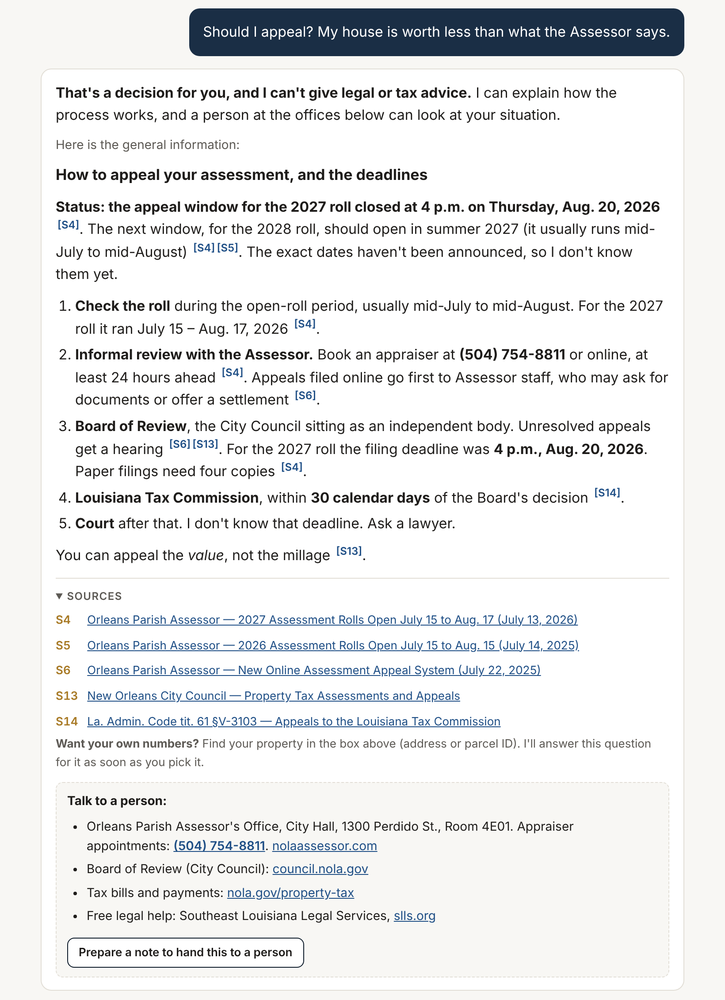

### A5. "Can I pay my property taxes in installments?"

**A correct answer needs:** No formal installment plan; partial payments in person or by mail; 1% a month interest; sourced.

**Complete answer:**

> Payment plans and partial payments
> 
> The City doesn't offer a formal installment plan for property taxes. You can make partial payments in person or by mail, but not online. Any unpaid balance is charged interest at 1% per month, plus other fees [S34].
> 
> For help with a bill you can't pay, contact the Bureau of the Treasury [S27]. If the problem is the value itself, that's a question for the Assessor's Office, and an appeal is only possible during the summer appeal window.
> 
> SOURCES
> S34 City of New Orleans Treasury — Paying taxes (payment plans, interest)
> S27 City of New Orleans — Pay Property Tax
> Talk to a person:
> Orleans Parish Assessor's Office, City Hall, 1300 Perdido St., Room 4E01. Appraiser appointments: (504) 754-8811. nolaassessor.com
> Board of Review (City Council): council.nola.gov
> Tax bills and payments: nola.gov/property-tax
> Free legal help: Southeast Louisiana Legal Services, slls.org
> Prepare a note to hand this to a person

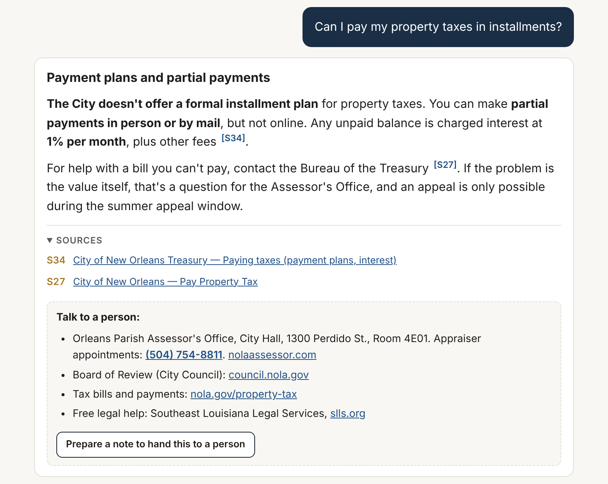

### A6. "I live in half of a double. Do I get the homestead exemption?"

**A correct answer needs:** What the law says (owned and occupied, one per person, ownership share), and a plain "I don't know" on how the rented half is treated; contacts.

**Complete answer:**

> Homestead when you live in half of a double
> 
> Short answer: you can get a homestead exemption on a double you own and live in, but I don't know exactly how the Assessor applies it to the rented half. That is a question for the Assessor's Office.
> 
> What the law says:
> 
> The exemption covers the home that is owned and occupied by the owner, up to $7,500 of assessed value [S2]. A rental you don't live in can't get it.
> One person or couple can have only one homestead exemption, so you can't claim both sides [S2].
> When a home has several owners, the exemption is limited to the ownership share of the owners who live there [S2]. In the 2026 roll, 1,358 parcels have a homestead recorded at 50% of ownership, and each gets $3,750 instead of $7,500 [S30].
> 
> What I don't know: whether the Assessor treats the rented side of an owner-occupied double differently, for example by applying the exemption only to your side's share of the value. The roll doesn't record which parcels are doubles. If you find your property above, I can show you the homestead amount and percentage on your record.
> 
> SOURCES
> S2 La. Const. Art. VII §20 (homestead exemption)
> S30 Louisiana Tax Commission — Orleans 2026 tax roll files, incl. millage by parcel (posted Nov. 2025)
> 
> Want your own numbers? Find your property in the box above (address or parcel ID). I'll answer this question for it as soon as you pick it.
> 
> Talk to a person:
> Orleans Parish Assessor's Office, City Hall, 1300 Perdido St., Room 4E01. Appraiser appointments: (504) 754-8811. nolaassessor.com
> Board of Review (City Council): council.nola.gov
> Tax bills and payments: nola.gov/property-tax
> Free legal help: Southeast Louisiana Legal Services, slls.org
> Prepare a note to hand this to a person

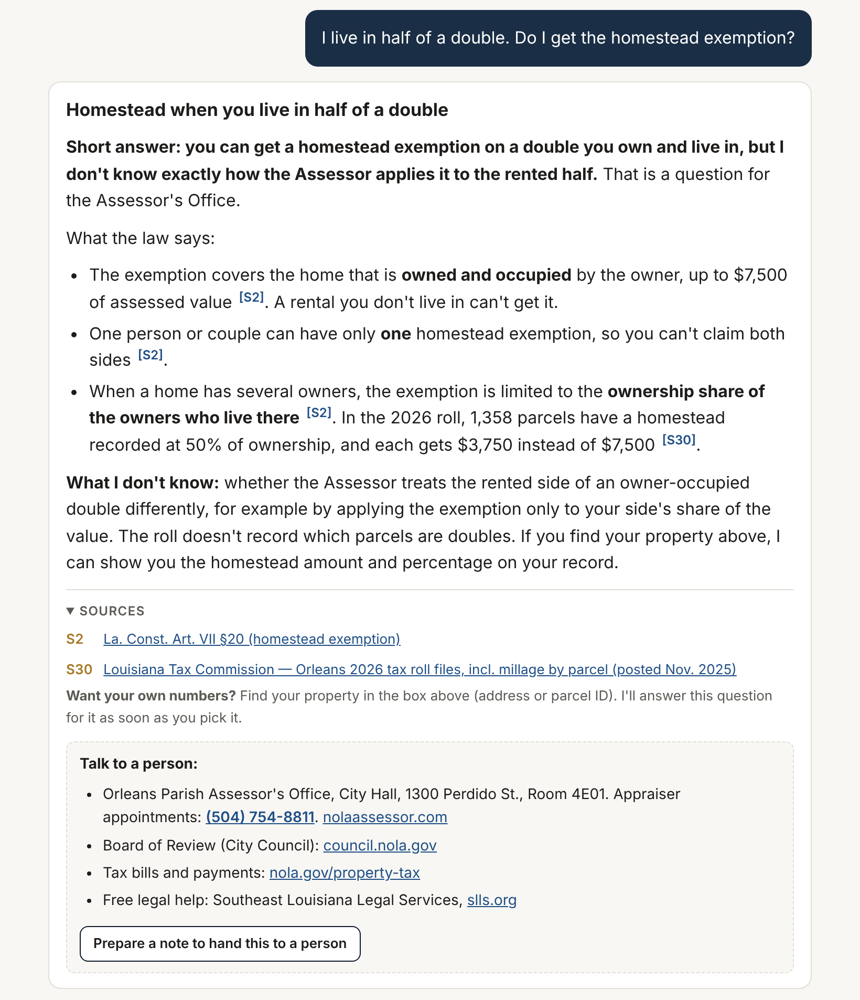

## B. Property questions (Part 2 test set)

Expected values were pulled from the raw 2026 roll and the state's millage files before the test ran (`tests/expected_from_raw.py`). A test passes only if every expected value appears in the answer.

### B1. Property: "1205 St. Charles Ave Apt 607" · Question: "What is my property's market value?"

**Expected (from the raw roll):** Recorded market value $145,700 = land $12,700 + buildings $133,000

**Result:** ✅ Pass

**Complete answer:**

> 1205 ST CHARLES AV 607 parcel 102000079
> RECORDED IN THE 2026 ROLL
> 
> Total market value: $145,700 (land $12,700 + buildings $133,000). Fields: Total, Land and Improvement Market Value.
> 
> WHAT IT MEANS
> 
> This is the Assessor's mass-appraisal estimate of what the property would sell for, not an appraisal of your specific house [S10]. It reflects the market as of 01/01/2023; values from the last reappraisal are used for tax years 2024 through 2027 [S15][S32]. The 2027 roll filed with the state keeps it at the same $145,700 [S31].
> 
> Source: Louisiana Tax Commission, Orleans Parish 2026 tax roll (LTC Expanded Real Estate Roll); 2027 figures: Louisiana Tax Commission, Orleans Parish 2027 tax roll, filed Sept. 4, 2026 (stax.latax.la.gov/TaxRollsFolder/2026). Parcel record as published; values as of 01/01/2023. LTC tax rolls
> 
> SOURCES
> S10 Orleans Parish Assessor — Mass appraisal process flyer
> S15 La. Legislative Auditor — Tax Year 2024 Quadrennial Reappraisal, Orleans Parish Assessor (Dec. 2023)
> S32 New Orleans City Council — Councilmember Green on assessments vs. taxes: 2024–27 values as of Jan. 1, 2023 (July 2023)
> S31 Louisiana Tax Commission — Orleans 2027 tax roll files (filed Sept. 4, 2026)

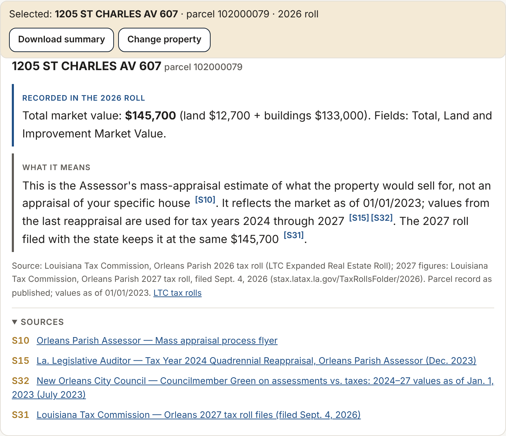

### B2. Property: "1205 St. Charles Ave Apt 607" · Question: "How much tax will I pay?"

**Expected (from the raw roll):** Recorded computed tax $1,019 on the 2026 roll ($1,030 on 2027), with the check and the special-district caveat

**Result:** ✅ Pass

**Complete answer:**

> 1205 ST CHARLES AV 607 parcel 102000079
> RECORDED IN THE 2026 AND 2027 ROLLS
> 
> Computed tax on the 2027 roll (your next bill, due early 2027): $1,030 at 133.48 mills, after a homestead reduction of $915 [S31].
> 
> Computed tax on the 2026 roll (bills that were due early 2026): $1,019, from 131.99 total mills, after a homestead reduction of $904. Taxable assessed value: $7,070 [S30].
> 
> CALCULATED BY THE NAVIGATOR
> 
> The 2027 file was filed Sept. 4, 2026, before the City Council approved a partial roll-forward of 4.039 mills on Nov. 5, 2026 [S33]. If those mills are added on top, this bill would rise by about $29 to $59 a year (4.039 × $7,070 taxable to × $14,570 assessed, depending on how much homestead reduces them ÷ 1,000). I don't know the final rates, so treat this as a range, not your bill.
> 
> CALCULATED BY THE NAVIGATOR
> 
> Check: $14,570 assessed × 131.99 mills ÷ 1,000 = $1,923, − $904 homestead reduction = $1,019. Matches the recorded amount.
> 
> WHAT IT MEANS
> 
> Homestead reduces every levy except the police and fire millages "without homestead exemption" (11.51 mills), so you still pay those on the first $7,500 [S30]. These totals don't include special-district fees such as the Downtown Development District or neighborhood security districts, which are billed separately [S17]. Your actual bill and due date come from the Bureau of the Treasury; 2026 bills were due Feb. 28, 2026, and the 2027 due date hasn't been announced [S35].
> 
> Source: Louisiana Tax Commission, Orleans Parish 2026 tax roll (LTC Expanded Real Estate Roll); 2027 figures: Louisiana Tax Commission, Orleans Parish 2027 tax roll, filed Sept. 4, 2026 (stax.latax.la.gov/TaxRollsFolder/2026). Parcel record as published; values as of 01/01/2023. LTC tax rolls
> 
> SOURCES
> S31 Louisiana Tax Commission — Orleans 2027 tax roll files (filed Sept. 4, 2026)
> S30 Louisiana Tax Commission — Orleans 2026 tax roll files, incl. millage by parcel (posted Nov. 2025)
> S33 Fox 8 — City Council approves millage roll-forward (Nov. 5, 2026) secondary
> S17 Bureau of Governmental Research — About Your Property Taxes secondary
> S35 City of New Orleans — 2026 property tax bills available, due Feb. 28, 2026 (Jan. 25, 2026)
> Talk to a person:
> Orleans Parish Assessor's Office, City Hall, 1300 Perdido St., Room 4E01. Appraiser appointments: (504) 754-8811. nolaassessor.com
> Board of Review (City Council): council.nola.gov
> Tax bills and payments: nola.gov/property-tax
> Free legal help: Southeast Louisiana Legal Services, slls.org
> Prepare a note to hand this to a person

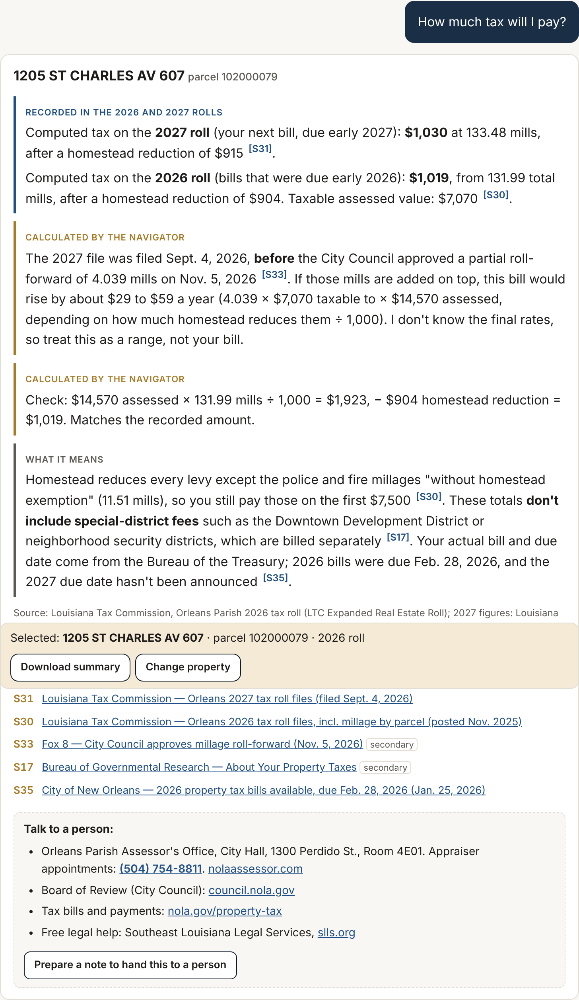

### B3. Property: "423 Gravier St #3A" · Question: "Do I have a homestead exemption?"

**Expected (from the raw roll):** Yes, $7,500 of assessed value

**Result:** ✅ Pass

**Complete answer:**

> 423 GRAVIER ST 3A parcel 105100749
> RECORDED IN THE 2026 ROLL
> 
> Homestead exemption: $7,500 of assessed value. Field: Homestead Exemption Amount.
> 
> RECORDED IN THE 2026 ROLL
> 
> Taxes the exemption removed on the 2026 roll: $904 a year (homestead reduction in the LTC millage file). Homestead doesn't reduce the police and fire "without homestead" millages [S30].
> 
> WHAT IT MEANS
> 
> The full exemption is $7,500 of assessed value, the first $75,000 of market value [S2]. Once granted, it stays on, and you don't reapply each year, unless something changes, like a sale or a change in ownership [S8].
> 
> Source: Louisiana Tax Commission, Orleans Parish 2026 tax roll (LTC Expanded Real Estate Roll). Parcel record as published; values as of 01/01/2023. LTC tax rolls
> 
> SOURCES
> S30 Louisiana Tax Commission — Orleans 2026 tax roll files, incl. millage by parcel (posted Nov. 2025)
> S2 La. Const. Art. VII §20 (homestead exemption)
> S8 Orleans Parish Assessor — Homestead flyer: Once Gained, Permanently Applied
> Talk to a person:
> Orleans Parish Assessor's Office, City Hall, 1300 Perdido St., Room 4E01. Appraiser appointments: (504) 754-8811. nolaassessor.com
> Board of Review (City Council): council.nola.gov
> Tax bills and payments: nola.gov/property-tax
> Free legal help: Southeast Louisiana Legal Services, slls.org
> Prepare a note to hand this to a person

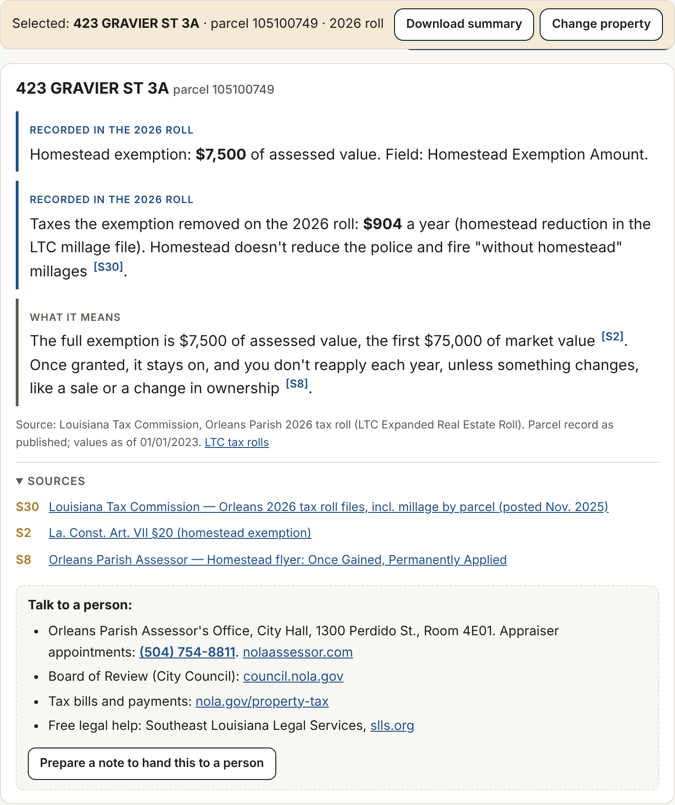

### B4. Property: *a home with an assessment freeze (address withheld)* · Question: "Why is my assessed value what it is?"

**Expected (from the raw roll):** $25,620 ÷ $325,000 = 7.9%, below 10% because of the freeze

**Result:** ✅ Pass

**Complete answer:**

> [address and parcel ID withheld]
> RECORDED IN THE 2026 ROLL
> 
> Assessed value: $25,620 (land $2,310 + buildings $23,310). Field: Total Assessed Value.
> 
> CALCULATED BY THE NAVIGATOR
> 
> $25,620 ÷ $325,000 market value = 7.9%.
> 
> WHAT IT MEANS
> 
> Louisiana assesses land and residential buildings at 10% of market value and other buildings, such as commercial ones, at 15% [S1]. Your record shows an assessment freeze, which is why the ratio can be below the usual 10% [S7].
> 
> Source: Louisiana Tax Commission, Orleans Parish 2026 tax roll (LTC Expanded Real Estate Roll). Parcel record as published; values as of 01/01/2023. LTC tax rolls
> 
> SOURCES
> S1 La. Const. Art. VII §18 (ratios, reappraisal every four years, phase-in, special assessment level)
> S7 Orleans Parish Assessor — Homestead & SAL

*Screenshot withheld: this record shows a benefit tied to age or disability, so the address isn't published.*

### B5. Property: *a home with a full disabled-veteran exemption (address withheld)* · Question: "Why is my taxable value zero?"

**Expected (from the raw roll):** $19,810 − $7,500 homestead − $12,310 veteran = $0 taxable, but the roll still computes $228 (police/fire millages)

**Result:** ✅ Pass

**Complete answer:**

> [address and parcel ID withheld]
> RECORDED IN THE 2026 ROLL
> 
> Taxable assessed value: $0. Field: Taxable Assessed Value.
> 
> CALCULATED BY THE NAVIGATOR
> 
> $19,810 assessed − $7,500 homestead − $12,310 veteran − $0 first responder − $0 other = $0 (never below $0). This matches the recorded value.
> 
> RECORDED IN THE 2026 ROLL
> 
> Even so, the roll computes $228 in 2026 tax on this parcel (LTC millage file) [S30].
> 
> CALCULATED BY THE NAVIGATOR
> 
> That's the police and fire millages "without homestead exemption" (11.51 mills), which still apply to the exempted value: $19,810 × 11.51 ÷ 1,000 = $228.
> 
> WHAT IT MEANS
> 
> Most millages are applied to the taxable value [S11]. A taxable value of $0 means your exemptions cover the whole assessed value for those millages; the police and fire millages without homestead exemption are the exception [S30].
> 
> Source: Louisiana Tax Commission, Orleans Parish 2026 tax roll (LTC Expanded Real Estate Roll). Parcel record as published; values as of 01/01/2023. LTC tax rolls
> 
> SOURCES
> S30 Louisiana Tax Commission — Orleans 2026 tax roll files, incl. millage by parcel (posted Nov. 2025)
> S11 City of New Orleans Treasury — Millages: How Taxes are Calculated (2026 millage table: 121.20 mills citywide)

*Screenshot withheld: this record shows a benefit tied to age or disability, so the address isn't published.*

### B6. Property: "1770 Tchoupitoulas St" · Question: "How much tax will I pay?"

**Expected (from the raw roll):** Taxable $0 because the parcel is exempt: other exemption $659,150 = full assessed value

**Result:** ✅ Pass

**Complete answer:**

> 1770 TCHOUPITOULAS ST parcel 101100301
> RECORDED IN THE 2026 AND 2027 ROLLS
> 
> Computed tax on the 2027 roll (your next bill, due early 2027): $0 at 133.48 mills [S31].
> 
> Computed tax on the 2026 roll (bills that were due early 2026): $0, from 131.99 total mills. Taxable assessed value: $0 [S30].
> 
> This parcel is exempt: an "other" exemption of $659,150 covers its whole assessed value (fields: Assessment Status = EX, Other Exemption Amount). Exempt parcels are usually government, religious or nonprofit property. The roll doesn't say which kind this is.
> 
> CALCULATED BY THE NAVIGATOR
> 
> Exemptions remove the whole $659,150 assessed value from every levy, so the computed tax is $0, as recorded.
> 
> WHAT IT MEANS
> 
> These totals don't include special-district fees such as the Downtown Development District or neighborhood security districts, which are billed separately [S17]. Your actual bill and due date come from the Bureau of the Treasury; 2026 bills were due Feb. 28, 2026, and the 2027 due date hasn't been announced [S35].
> 
> Source: Louisiana Tax Commission, Orleans Parish 2026 tax roll (LTC Expanded Real Estate Roll); 2027 figures: Louisiana Tax Commission, Orleans Parish 2027 tax roll, filed Sept. 4, 2026 (stax.latax.la.gov/TaxRollsFolder/2026). Parcel record as published; values as of 01/01/2023. LTC tax rolls
> 
> SOURCES
> S31 Louisiana Tax Commission — Orleans 2027 tax roll files (filed Sept. 4, 2026)
> S30 Louisiana Tax Commission — Orleans 2026 tax roll files, incl. millage by parcel (posted Nov. 2025)
> S17 Bureau of Governmental Research — About Your Property Taxes secondary
> S35 City of New Orleans — 2026 property tax bills available, due Feb. 28, 2026 (Jan. 25, 2026)
> Talk to a person:
> Orleans Parish Assessor's Office, City Hall, 1300 Perdido St., Room 4E01. Appraiser appointments: (504) 754-8811. nolaassessor.com
> Board of Review (City Council): council.nola.gov
> Tax bills and payments: nola.gov/property-tax
> Free legal help: Southeast Louisiana Legal Services, slls.org
> Prepare a note to hand this to a person

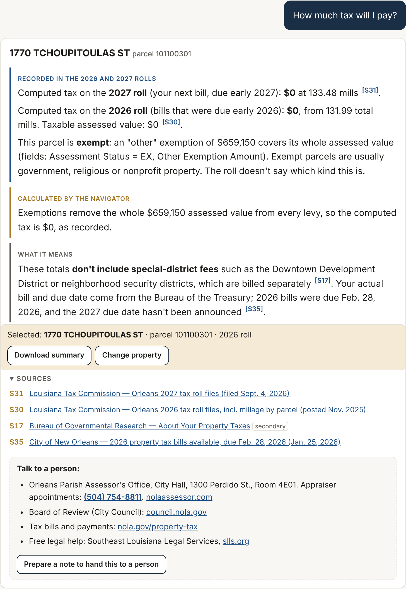

### B7. Property: *the frozen home from test 4 (address withheld)* · Question: "How did my value change from 2025?"

**Expected (from the raw roll):** Can't compare with 2025 (not available); 2026 → 2027: market $325,000 → $334,900, tax $2,478 → $2,505

**Result:** ✅ Pass

**Complete answer:**

> [address and parcel ID withheld]
> RECORDED IN THE 2026 AND 2027 ROLLS
> Market value	$325,000 → $334,900	2026 → 2027 roll
> Taxable assessed value	$18,120 → $18,120	2026 → 2027 roll
> Total mills	131.99 → 133.48	LTC millage files
> Computed tax	$2,478 → $2,505	LTC millage files
> CALCULATED BY THE NAVIGATOR
> 
> Market value changed by +$9,900 (+3%). Computed tax changed by +$27. What changed: the market value changed (+$9,900); the total millage changed (131.99 → 133.48). Taxable value stayed the same because of the assessment freeze on this parcel.
> 
> CALCULATED BY THE NAVIGATOR
> 
> The 2027 file was filed Sept. 4, 2026, before the City Council approved a partial roll-forward of 4.039 mills on Nov. 5, 2026 [S33]. If those mills are added on top, this bill would rise by about $73 to $103 a year (4.039 × $18,120 taxable to × $25,620 assessed, depending on how much homestead reduces them ÷ 1,000). I don't know the final rates, so treat this as a range, not your bill.
> 
> WHAT IT MEANS
> 
> Compared by parcel ID 101101410. Values from the last reappraisal (market as of Jan. 1, 2023) are used for tax years 2024 through 2027 [S15][S32], so 98% of parcels keep the same value on the 2027 roll [S31]. Between reappraisals a value can still change for a sale, construction, demolition, damage or remodeling [S15]. On the East Bank the total millage rises because the levee district's rate goes from 10.79 to 12.28 mills. The four-year pattern points to tax year 2028 for the next reappraisal (my inference; confirm with the Assessor). I can't compare with 2025: that roll isn't available to me.
> 
> Source: Louisiana Tax Commission, Orleans Parish 2026 tax roll (LTC Expanded Real Estate Roll); 2027 figures: Louisiana Tax Commission, Orleans Parish 2027 tax roll, filed Sept. 4, 2026 (stax.latax.la.gov/TaxRollsFolder/2026). Parcel record as published; values as of 01/01/2023. LTC tax rolls
> 
> SOURCES
> S33 Fox 8 — City Council approves millage roll-forward (Nov. 5, 2026) secondary
> S15 La. Legislative Auditor — Tax Year 2024 Quadrennial Reappraisal, Orleans Parish Assessor (Dec. 2023)
> S32 New Orleans City Council — Councilmember Green on assessments vs. taxes: 2024–27 values as of Jan. 1, 2023 (July 2023)
> S31 Louisiana Tax Commission — Orleans 2027 tax roll files (filed Sept. 4, 2026)
> Talk to a person:
> Orleans Parish Assessor's Office, City Hall, 1300 Perdido St., Room 4E01. Appraiser appointments: (504) 754-8811. nolaassessor.com
> Board of Review (City Council): council.nola.gov
> Tax bills and payments: nola.gov/property-tax
> Free legal help: Southeast Louisiana Legal Services, slls.org
> Prepare a note to hand this to a person

*Screenshot withheld: this record shows a benefit tied to age or disability, so the address isn't published.*

### B8. Property: "1205 St. Charles Ave Apt 607" · Question: "How many square feet is my house?"

**Expected (from the raw roll):** I don't know: square footage isn't in this roll

**Result:** ✅ Pass

**Complete answer:**

> 1205 ST CHARLES AV 607 parcel 102000079
> NOT IN THIS RECORD
> 
> I don't know. This roll doesn't include square footage, bedrooms, bathrooms, condition or features: those fields are blank or zero for every parcel. The Assessor's property search may show them, and wrong building details are one of the easiest things to get corrected [S10].
> 
> Source: Louisiana Tax Commission, Orleans Parish 2026 tax roll (LTC Expanded Real Estate Roll). Parcel record as published; values as of 01/01/2023. LTC tax rolls
> 
> SOURCES
> S10 Orleans Parish Assessor — Mass appraisal process flyer
> Talk to a person:
> Orleans Parish Assessor's Office, City Hall, 1300 Perdido St., Room 4E01. Appraiser appointments: (504) 754-8811. nolaassessor.com
> Board of Review (City Council): council.nola.gov
> Tax bills and payments: nola.gov/property-tax
> Free legal help: Southeast Louisiana Legal Services, slls.org
> Prepare a note to hand this to a person

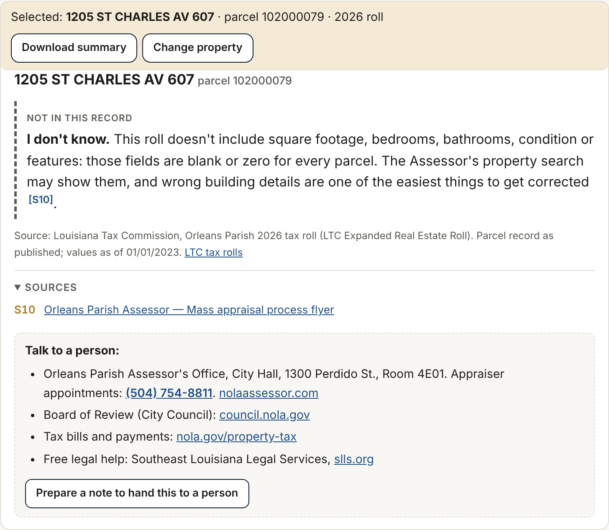

### B9. Property: "1205 St. Charles Ave Apt 607" · Question: "Who owns this property?"

**Expected (from the raw roll):** Won't show owner names (privacy); points to the Assessor's search

**Result:** ✅ Pass

**Complete answer:**

> 1205 ST CHARLES AV 607 parcel 102000079
> NOT IN THIS RECORD
> 
> I don't show owner names or mailing addresses. The roll has them, but this prototype leaves them out for privacy. The Assessor's property search shows the owner of record.
> 
> Source: Louisiana Tax Commission, Orleans Parish 2026 tax roll (LTC Expanded Real Estate Roll). Parcel record as published; values as of 01/01/2023. LTC tax rolls
> 
> Talk to a person:
> Orleans Parish Assessor's Office, City Hall, 1300 Perdido St., Room 4E01. Appraiser appointments: (504) 754-8811. nolaassessor.com
> Board of Review (City Council): council.nola.gov
> Tax bills and payments: nola.gov/property-tax
> Free legal help: Southeast Louisiana Legal Services, slls.org
> Prepare a note to hand this to a person

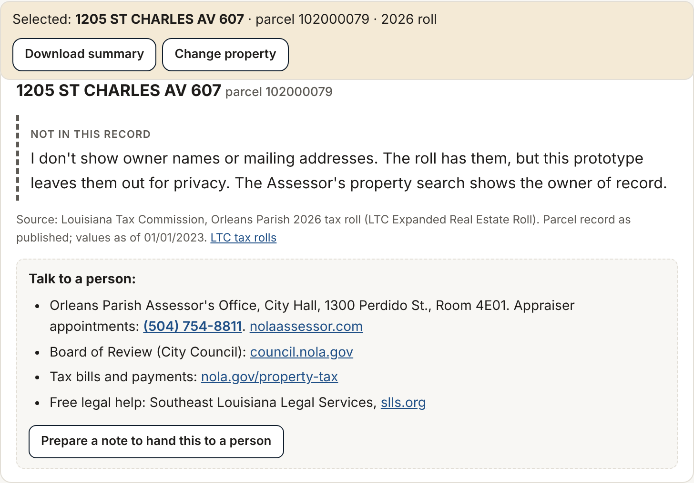

### B10. Search: "701 S Claiborne Ave"

**Expected (from the raw roll):** 3 records share the address; the one whose legal description says S CLAIBORNE (District 1) is listed first

**Result:** ✅ Pass

**Complete answer:**

> 3 records match "701 S Claiborne Ave". 3 records share this address. Pick yours. 1 of them has "S CLAIBORNE" in the legal description, listed first.
> 
> 701 CLAIBORNE AV
> Vacant Land · District 1, Ward 03 · Hospital District · Market value $97,500 · Parcel 103107307
> SQ 460 LOT 7 S CLAIBORNE & LAFAYETTE 31' 4" X 100' LOT 8 CLAIBORNE 26' X 100'
> 701 CLAIBORNE AV
> Vacant Land · District 2, Ward 07 · Faubourg Lafitte · Market value $37,900 · Parcel 207110718
> SQ 211-A LOT 118 N CLAIBORNE 24 X 79 DOCKET #93/08 LAFITTE TREME HOUSING REDEVELOPMENT EXE
> 701 CLAIBORNE AV
> Exempt · District 2, Ward 07 · Faubourg Lafitte · Market value $98,800 · Parcel 207110736
> SQ 211-A LOT 118 N CLAIBORNE 24 X 79 DOCKET #93/08 LAFITTE TREME HOUSING REDEVELOPMENT IMP
> 
> Choose the record that's yours. If none are, try another spelling or your parcel ID.

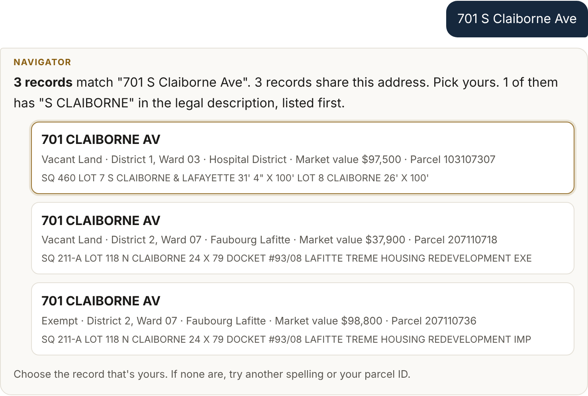

## C. Demo conversation (one session, in order)

### C1. Find your property: "1205 St. Charles Ave, Apt 607"

**A correct answer needs:** One record; property card with recorded values.

**Complete answer (search result, then the record after picking it):**

> I found one record for "1205 St. Charles Ave, Apt 607". Is this your property?
> 
> 1205 ST CHARLES AV 607
> Residential · District 1, Ward 02 · Carondelet Corridor · Market value $145,700 · Parcel 102000079
> SQ 213 LOTS X,B,C OR UNDESIGNATED, 3&2, 4A, 3&X ST CHARL ES, ERATO & CLIO .37% INST. UNIT
> 
> Choose the record that's yours. If none are, try another spelling or your parcel ID.

> 1205 ST CHARLES AV 607
> 
> Parcel 102000079 · Residential · District 1, Ward 02 · Carondelet Corridor
> 
> RECORDED IN THE 2026 ROLL
> Market value (land)	$12,700	Land Market Value
> Market value (buildings)	$133,000	Improvement Market Value
> Total market value	$145,700	Total Market Value
> Assessed value	$14,570	Total Assessed Value
> Homestead exemption	$7,500	Homestead Exemption Amount
> Taxable assessed value	$7,070	Taxable Assessed Value
> Computed tax, 2026 roll	$1,019	LTC millage file (AMILLAGE)
> Market value, 2027 roll	$145,700 (same)	2027 roll, market value
> Computed tax, 2027 roll	$1,030 (filed before the Nov. 5 roll-forward)	2027 roll, LTC millage file
> Assessment freeze	None	Freeze Code(s)
> 
> Source: Louisiana Tax Commission, Orleans Parish 2026 tax roll (LTC Expanded Real Estate Roll); 2027 figures: Louisiana Tax Commission, Orleans Parish 2027 tax roll, filed Sept. 4, 2026 (stax.latax.la.gov/TaxRollsFolder/2026). Parcel record as published; values as of 01/01/2023. LTC tax rolls
> 
> Ask me about this property, like "How much tax will I pay?" or "Do I have a homestead exemption?" Answers label what's recorded in the roll, what I calculated, and the general explanation.

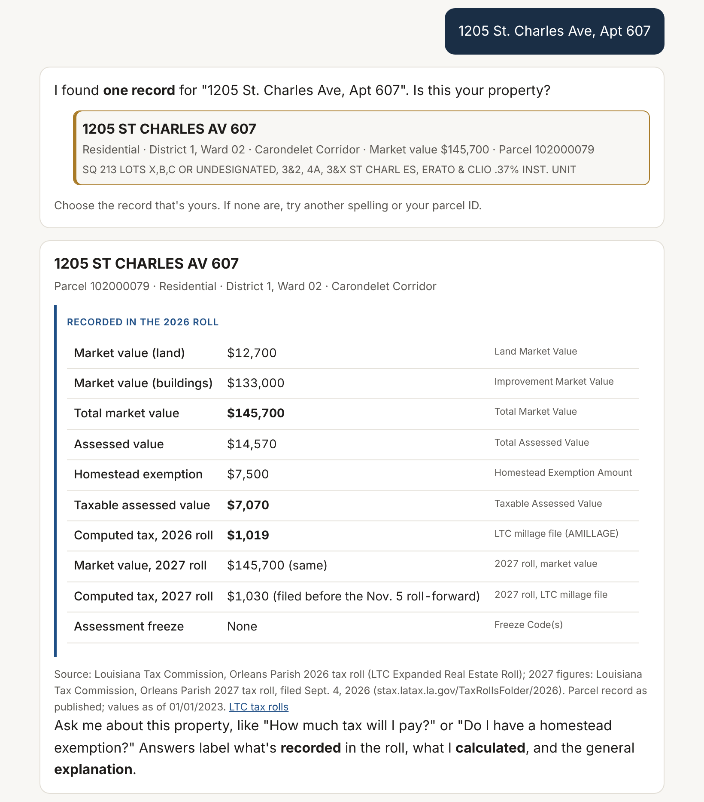

### C2. "How much tax will I pay?"

**A correct answer needs:** Leads with the next bill (2027 roll), then 2026; calculated check; roll-forward range; labeled recorded / calculated / explanation.

**Complete answer:**

> 1205 ST CHARLES AV 607 parcel 102000079
> RECORDED IN THE 2026 AND 2027 ROLLS
> 
> Computed tax on the 2027 roll (your next bill, due early 2027): $1,030 at 133.48 mills, after a homestead reduction of $915 [S31].
> 
> Computed tax on the 2026 roll (bills that were due early 2026): $1,019, from 131.99 total mills, after a homestead reduction of $904. Taxable assessed value: $7,070 [S30].
> 
> CALCULATED BY THE NAVIGATOR
> 
> The 2027 file was filed Sept. 4, 2026, before the City Council approved a partial roll-forward of 4.039 mills on Nov. 5, 2026 [S33]. If those mills are added on top, this bill would rise by about $29 to $59 a year (4.039 × $7,070 taxable to × $14,570 assessed, depending on how much homestead reduces them ÷ 1,000). I don't know the final rates, so treat this as a range, not your bill.
> 
> CALCULATED BY THE NAVIGATOR
> 
> Check: $14,570 assessed × 131.99 mills ÷ 1,000 = $1,923, − $904 homestead reduction = $1,019. Matches the recorded amount.
> 
> WHAT IT MEANS
> 
> Homestead reduces every levy except the police and fire millages "without homestead exemption" (11.51 mills), so you still pay those on the first $7,500 [S30]. These totals don't include special-district fees such as the Downtown Development District or neighborhood security districts, which are billed separately [S17]. Your actual bill and due date come from the Bureau of the Treasury; 2026 bills were due Feb. 28, 2026, and the 2027 due date hasn't been announced [S35].
> 
> Source: Louisiana Tax Commission, Orleans Parish 2026 tax roll (LTC Expanded Real Estate Roll); 2027 figures: Louisiana Tax Commission, Orleans Parish 2027 tax roll, filed Sept. 4, 2026 (stax.latax.la.gov/TaxRollsFolder/2026). Parcel record as published; values as of 01/01/2023. LTC tax rolls
> 
> SOURCES
> S31 Louisiana Tax Commission — Orleans 2027 tax roll files (filed Sept. 4, 2026)
> S30 Louisiana Tax Commission — Orleans 2026 tax roll files, incl. millage by parcel (posted Nov. 2025)
> S33 Fox 8 — City Council approves millage roll-forward (Nov. 5, 2026) secondary
> S17 Bureau of Governmental Research — About Your Property Taxes secondary
> S35 City of New Orleans — 2026 property tax bills available, due Feb. 28, 2026 (Jan. 25, 2026)
> Talk to a person:
> Orleans Parish Assessor's Office, City Hall, 1300 Perdido St., Room 4E01. Appraiser appointments: (504) 754-8811. nolaassessor.com
> Board of Review (City Council): council.nola.gov
> Tax bills and payments: nola.gov/property-tax
> Free legal help: Southeast Louisiana Legal Services, slls.org
> Prepare a note to hand this to a person

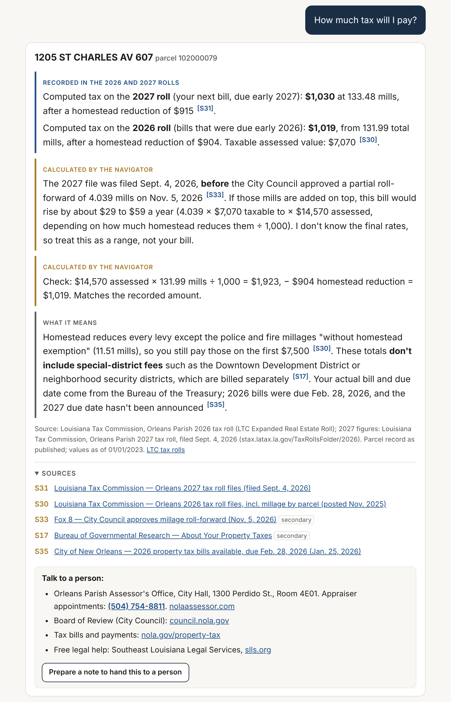

### C3. "How do I apply for the homestead exemption?"

**A correct answer needs:** General answer plus a "Your property" panel showing the homestead already on this record.

**Complete answer:**

> How to apply for the homestead exemption
> 
> The homestead exemption takes $7,500 off your assessed value, which equals the first $75,000 of market value. It applies only to the home you own and live in, and you must own and occupy it by December 31 of the year you claim it [S2][S3]. A person or married couple can have only one [S2].
> 
> How to apply: you apply with the Orleans Parish Assessor's Office, City Hall, 1300 Perdido St., Room 4E01 [S9]. The Assessor's application form and flyer ask for [S8][S9]:
> 
> Proof of ownership: act of sale or deed
> A Louisiana driver's license or state ID showing the property address
> A current Entergy (or cable) bill for the property, with matching name, service address and mailing address
> 
> Those documents say every owner who lives in the home applies in person, and that a mailing address different from the property needs a recorded power of attorney [S8][S9]. They date from 2021 and 2024, and I can't check the Assessor's website myself, so please confirm the current steps (including whether you can apply online or by appointment) at nolaassessor.com or by phone before you go.
> 
> What it saves: about $903.60 a year on the East Bank at 2026 rates ($7,500 × 120.48 mills). It lowers most of your bill but not all of it: the police and fire millages "without applying homestead exemption" (11.51 of the 131.99 mills) are charged on your full assessed value [S11][S30].
> 
> SOURCES
> S2 La. Const. Art. VII §20 (homestead exemption)
> S3 La. R.S. 47:1703 (homestead statute)
> S9 Orleans Parish Assessor — Homestead Exemption application
> S8 Orleans Parish Assessor — Homestead flyer: Once Gained, Permanently Applied
> S11 City of New Orleans Treasury — Millages: How Taxes are Calculated (2026 millage table: 121.20 mills citywide)
> S30 Louisiana Tax Commission — Orleans 2026 tax roll files, incl. millage by parcel (posted Nov. 2025)
> YOUR PROPERTY: 1205 ST CHARLES AV 607 · PARCEL 102000079
> 
> A homestead exemption of $7,500 is on this parcel (Homestead Exemption Amount), removing $904 of 2026 tax.
> 
> From the 2026 roll and the 2027 roll filed with the state; values as of 01/01/2023 [S30][S31]. Ask about it directly (like "How much tax will I pay?") for the full breakdown.
> 
> Talk to a person:
> Orleans Parish Assessor's Office, City Hall, 1300 Perdido St., Room 4E01. Appraiser appointments: (504) 754-8811. nolaassessor.com
> Board of Review (City Council): council.nola.gov
> Tax bills and payments: nola.gov/property-tax
> Free legal help: Southeast Louisiana Legal Services, slls.org
> Prepare a note to hand this to a person

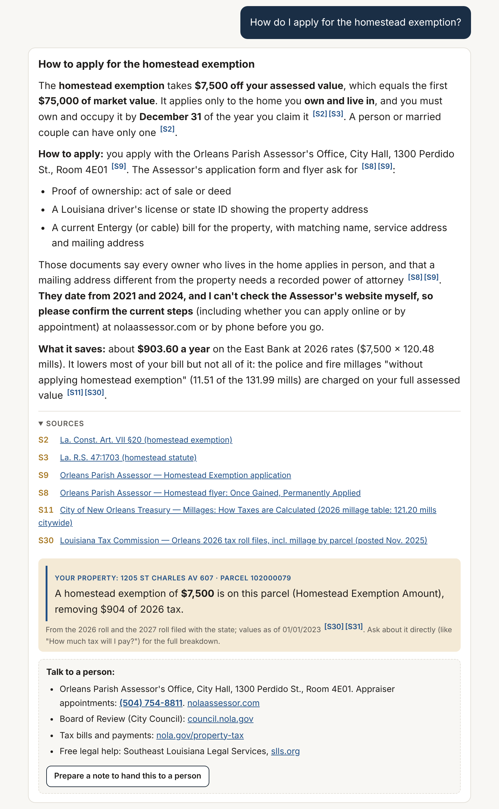

### C4. "How does my property compare to others in my area?"

**A correct answer needs:** Layer 3: distribution of similar parcels; says it doesn't mean the value is too high or low.

**Complete answer:**

> 1205 ST CHARLES AV 607 parcel 102000079
> CALCULATED BY THE NAVIGATOR FROM THE 2026 AND 2027 ROLLS
> 
> Compared with the 271 residential parcels in the "Carondelet Corridor" area of District 1:
> 
> Market value, middle half	$133,400 to $202,400 (middle value $152,500)	Total Market Value, 2026 roll
> This parcel	$145,700: in the lower half, below the middle value	Total Market Value
> Share with a homestead exemption	20.7%	Homestead Exemption Amount
> Share with an assessment freeze	1.5%	Freeze Code(s)
> Middle computed tax	$1,938 (2026) → $2,036 (2027)	LTC millage files
> This parcel's computed tax	$1,019 → $1,030	LTC millage files
> Market value changed on the 2027 roll	1.8% of these parcels; this one didn't change	2026 vs 2027 roll, by parcel ID
> Tax change, 2026 → 2027	middle +$23; this parcel +$10	LTC millage files
> WHAT IT MEANS
> 
> This only describes how values are spread in the area. It doesn't mean your value is too high or too low: parcels differ in size, condition, lot and use, and this roll doesn't include building size, so I can't compare like with like. "Area" here is the roll's Subdivision field, which may not match the neighborhoods the Assessor uses to set values. Values are from the 2026 roll [S30]; the 2027 figures are from the roll filed with the state [S31].
> 
> Source: Louisiana Tax Commission, Orleans Parish 2026 tax roll (LTC Expanded Real Estate Roll); 2027 figures: Louisiana Tax Commission, Orleans Parish 2027 tax roll, filed Sept. 4, 2026 (stax.latax.la.gov/TaxRollsFolder/2026). Parcel record as published; values as of 01/01/2023. LTC tax rolls
> 
> SOURCES
> S30 Louisiana Tax Commission — Orleans 2026 tax roll files, incl. millage by parcel (posted Nov. 2025)
> S31 Louisiana Tax Commission — Orleans 2027 tax roll files (filed Sept. 4, 2026)

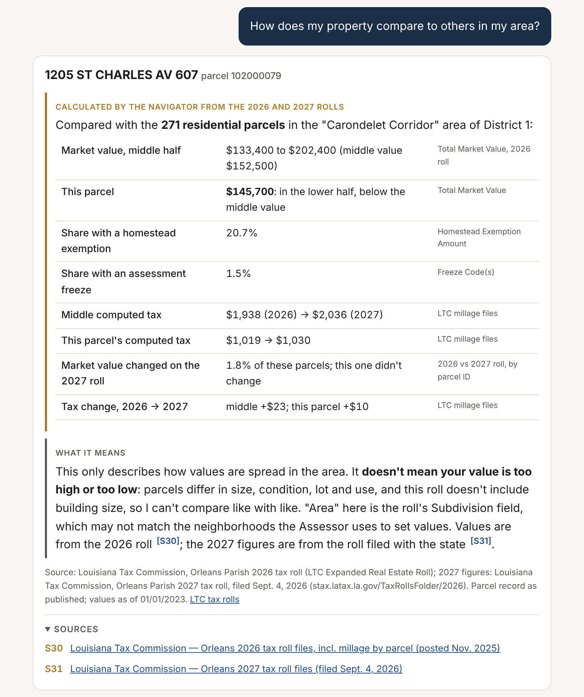

### C5. "Should I appeal my assessment?"

**A correct answer needs:** Refuses advice; shows the record and human contacts.

**Complete answer:**

> That's a decision for you, and I can't give legal or tax advice. I can explain how the process works, and a person at the offices below can look at your situation.
> 
> Here is what your record shows:
> 
> 1205 ST CHARLES AV 607 parcel 102000079
> RECORDED IN THE 2026 ROLL
> 
> Assessed value: $14,570 (land $1,270 + buildings $13,300). Field: Total Assessed Value.
> 
> CALCULATED BY THE NAVIGATOR
> 
> $14,570 ÷ $145,700 market value = 10%.
> 
> WHAT IT MEANS
> 
> Louisiana assesses land and residential buildings at 10% of market value and other buildings, such as commercial ones, at 15% [S1]. Your assessed value is exactly 10% of market value, which is the rule for land and homes.
> 
> Source: Louisiana Tax Commission, Orleans Parish 2026 tax roll (LTC Expanded Real Estate Roll). Parcel record as published; values as of 01/01/2023. LTC tax rolls
> 
> SOURCES
> S1 La. Const. Art. VII §18 (ratios, reappraisal every four years, phase-in, special assessment level)
> Talk to a person:
> Orleans Parish Assessor's Office, City Hall, 1300 Perdido St., Room 4E01. Appraiser appointments: (504) 754-8811. nolaassessor.com
> Board of Review (City Council): council.nola.gov
> Tax bills and payments: nola.gov/property-tax
> Free legal help: Southeast Louisiana Legal Services, slls.org
> Prepare a note to hand this to a person

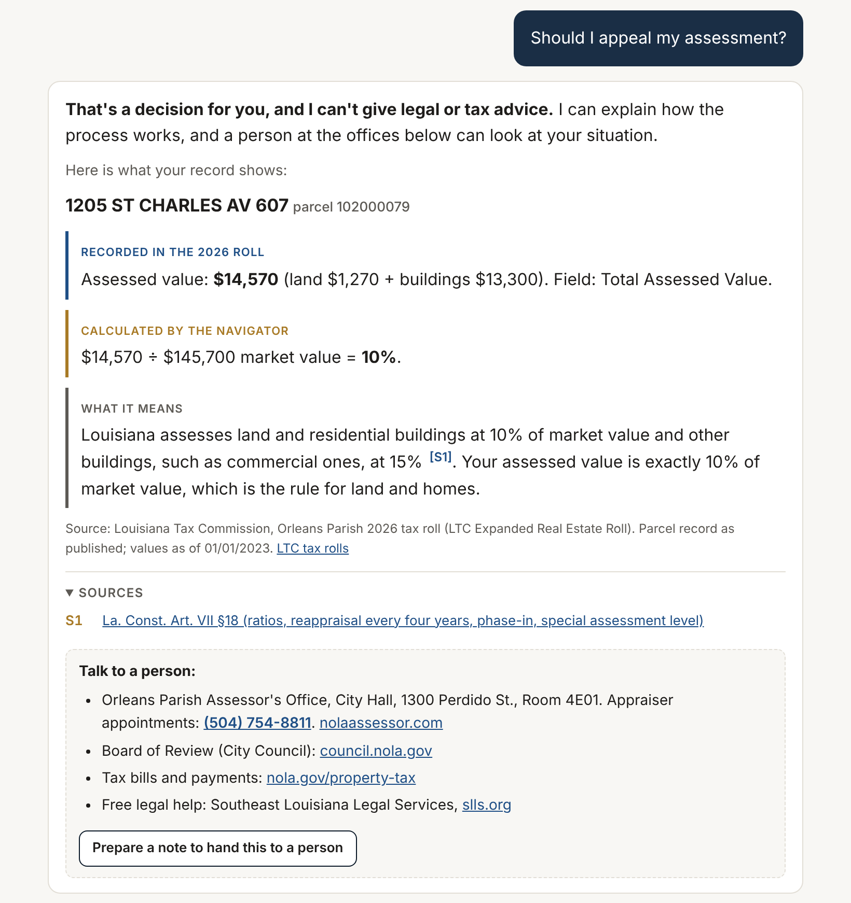
