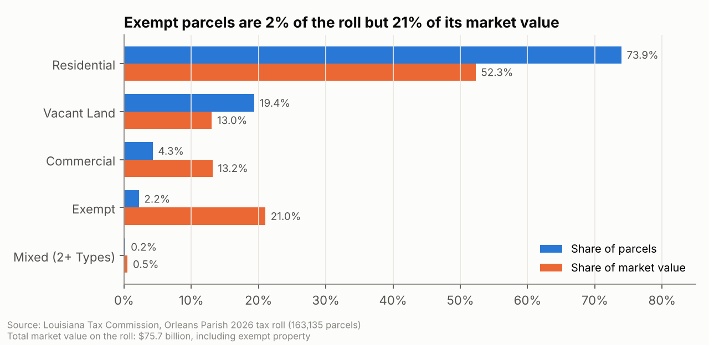
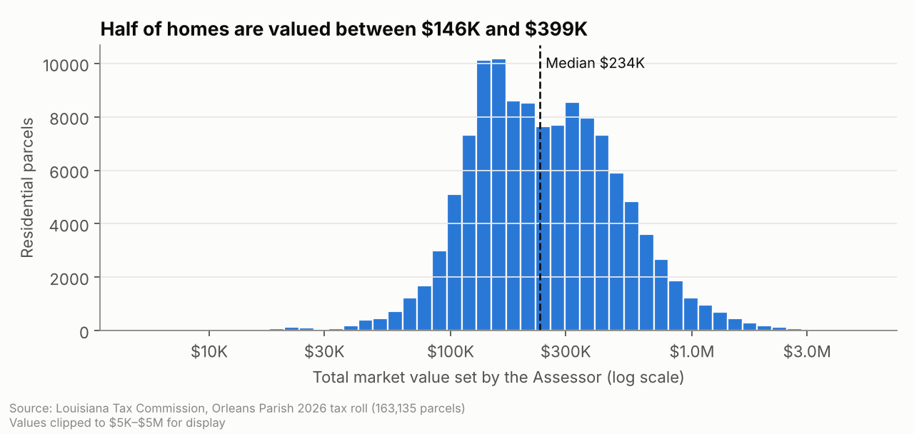
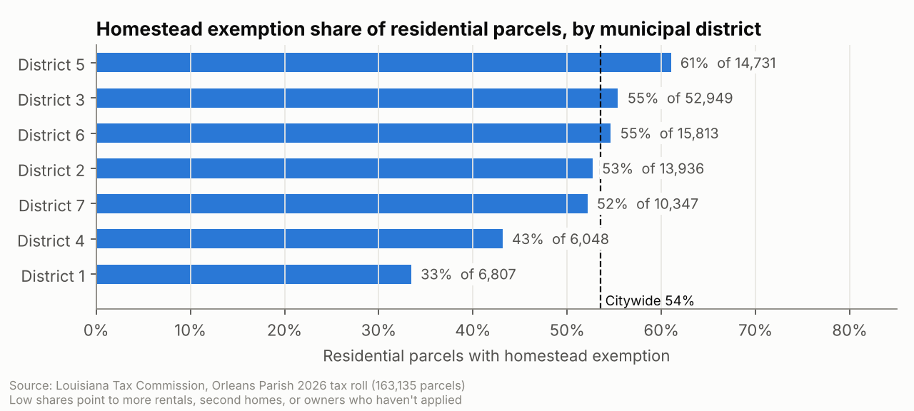
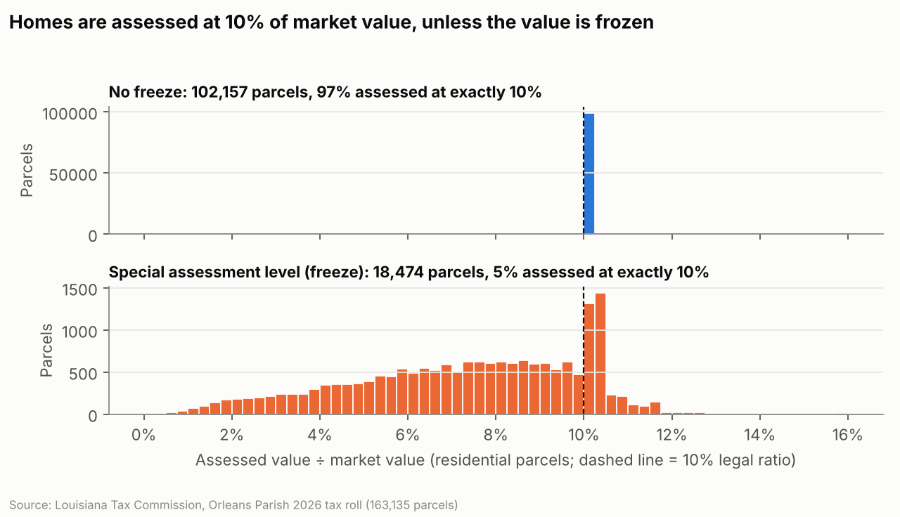
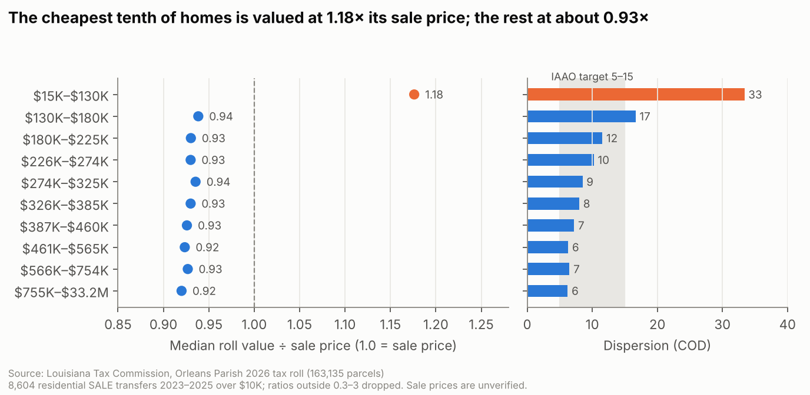
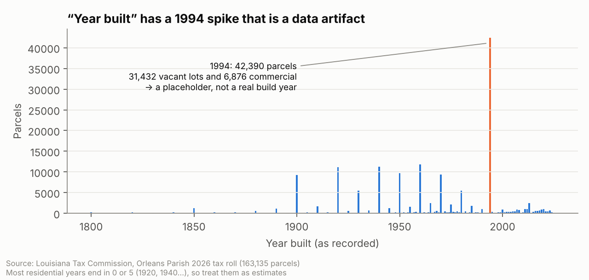
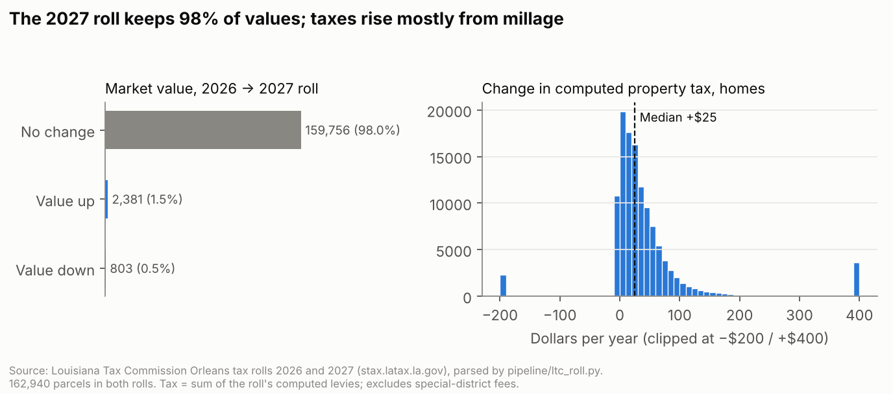

# NOLA Assessment Navigator, Part 2: Data Exploration, Property Lookup, and Chatbot

**Live chatbot:** https://claude.ai/artifact/PMnTiHc5EGih7pzGky6bWB. Find a property by address or parcel ID, confirm the
record, then ask about it.
**Data:** `Orleans_Parish_2026_LTC_Expanded_Real_Estate_Roll.csv`: Louisiana Tax Commission 2026 roll, 163,135 parcels,
115 columns.
**Code:** `pipeline/` (analysis and export), `address.js` + `lookup.js` (matching), `property.js` (property answers),
`tests/` (all checks below are rerunnable).

**Where each requirement is answered:**

| Assignment item | Where |
|---|---|
| 1. EDA: 3–5 charts with a paragraph each, plus a finding verified independently | §1: Figures 1–5, then "Verifying a finding independently" |
| 2. Data dictionary, plus what we couldn't figure out | §2, and all 115 fields in Appendix A (`docs/data-dictionary.md`) |
| 3. Address matching tested on 10+ addresses: how many matched, and why any failed | §3, and all 19 results in Appendix B (`docs/address-matching-results.md`) |
| 4. One outside source pulled by API, saved and documented | §4: Census ACS by tract; `data/outside/`, `docs/outside-data.md` |
| 5. 10 test questions: expected answer vs. what the chatbot did | §5, and screenshots of every answer in Appendix C |
| Live link to the current chatbot | Top of this page |
| Compare 2025 and 2026 by a consistent ID | §4b: 2025 isn't available, so 2026 vs 2027 by parcel ID |
| Property lookup: address variations, multiple matches, missing records | §3, and the live chatbot's "Find your property" box |
| Property records connected to the chatbot (data year, source, missing info, "can't answer") | §5; every property answer labels what was recorded, calculated and explained |
| Evaluate outside data and matching limits | §4 |
| CLAUDE.md updated as we learned | `CLAUDE.md` §3 (Data), §4 (rules 7–8), §6–8 |

---

## 1. Exploratory data analysis

The agent ran `pipeline/eda.py`, which also writes every number below to `docs/eda/eda_numbers.json`. First it checked that
the roll's own arithmetic holds. On **all 163,135 rows**:
- market value = land + buildings
- assessed value = land + buildings (assessed)
- taxable value = assessed − homestead − veteran − first responder − other exemptions, never below $0
- Parcel ID = Tax Bill #
- the homestead exemption never exceeds $7,500

**Figure 1: What's on the roll, by count and by value** (`docs/eda/fig1_share_parcels_value.png`)

Residential parcels are 74% of the roll but 52% of its $75.7 billion market value. **Exempt parcels are only 2.2% of
parcels but 21% of the value.** These are large institutional properties: City Park ($1.39 billion), the LSU and VA
medical centers (about $1 billion each), Tulane, the Convention Center, the Superdome and the Port. None of that value is
taxed. Commercial parcels are 4% of the count
and 13% of the value. 14,841 parcels have a taxable value of $0: exempt property, vacant land with an "other"
exemption, and 4,197 homes whose exemptions cover the whole assessed value.

**Figure 2: How residential values are distributed** (`docs/eda/fig2_residential_values.png`)

The median home is valued at **$233,600**, and half of homes fall between **$145,900 and $398,550**. The 10% at the top
are above $611,800. These are the Assessor's mass-appraisal values as of 01/01/2023, not current sale prices.

**Figure 3: Homestead exemption by district** (`docs/eda/fig3_homestead_by_district.png`)

Citywide, **54% of residential parcels** have a homestead exemption. That ranges from **61% in District 5** to
**33% in District 1**. A low share can reflect more rentals, second
homes and short-term rentals, or owners who live there but haven't applied. That makes it a useful map for homestead
outreach.

**Figure 4: The 10% rule, and the freeze exception** (`docs/eda/fig4_assessment_ratio.png`)

For homes without a freeze, **97% are assessed at exactly 10% of market value**, the legal ratio in La. Const.
Art. VII §18. The 18,474 homes with a **special assessment level (freeze)** are spread below that, with a median of **7.6%**,
because their assessed value was locked when the owner qualified while market value rose. This one chart shows two rules
from the education outline working in the data.

**Figure 5: Are cheaper homes over-assessed? (the client's question)** (`docs/eda/fig5_sales_ratio_by_price.png`)

For 8,604 residential sales from 2023–2025, we compare the roll's market value with the sale price. The middle and top
of the market sit at **0.92–0.94× the sale price**. The **cheapest tenth ($15K–$130K) sits at 1.18×**, with dispersion
(COD 33) more than twice the IAAO target band of 5–15. Taken at face value, owners of the least expensive homes are
assessed at more than they sold for, while everyone else is assessed below. That's the regressivity concern the
project's client raised.

**Caveats before anyone acts on it:**
- None of the roll's sale prices are marked verified.
- The cheapest tenth likely includes distressed and non-market sales. Including every deed type (sheriff's sales,
  successions and other non-SALE transfers) raises that tenth to 1.41×.
- Values are as of 01/01/2023, so later sales include appreciation.
- With 2021–22 sales, from before the valuation date (and with slightly different filters: SALE, SALW and CASH documents, prices of $25K or more), the cheapest tenth is at 1.05×. The gap is smaller there, but it
  points the same way.

**A related pattern:** 19% of these sales (40% of 2023 sales) carry a roll value at almost exactly **92% of the sale
price**, and 15% at exactly 92% rounded to $100. That suggests values are reset when a home sells ("sales chasing"),
which would also make sales-based accuracy measures look better than they are for homes that haven't sold.

**Appendix figure A1: a data-quality warning** (`docs/eda/figA1_year_built.png`)

"Year built" spikes at **1994: 42,390 parcels**, of which 31,432 are vacant lots and 6,876 commercial. That's a
placeholder, not a building boom. Residential years are rounded too: 79% end in 0 or 5. The app hides 1994 for
non-residential parcels and calls residential years approximate.

### Verifying a finding independently

We rechecked the Figure 4 finding a second way, with Python's built-in `csv` reader instead of pandas, reading the raw file
directly:
- **No freeze:** 99,289 of 102,157 homes at exactly 10% (**97.19%**)
- **Freeze:** 963 of 18,474 (**5.21%**)

Both match the EDA. We also traced one parcel by hand. For **1205 St Charles Av #607**, land $12,700 + building
$133,000 = $145,700 market value. × 10% = $14,570 assessed, − $7,500 homestead = **$7,070 taxable**, exactly what the roll
records.

**To reproduce it in Excel** (the file's 163,135 rows fit within Excel's limit): filter Occupancy Type = RESIDENTIAL and
Freeze Code = 0, add a column `=Total Assessed Value / Total Market Value`, and count the rows equal to 0.1. The
result should be 99,289 of 102,157.

**Second check: replicating the class model EDA.** The Oct. 28 class recording shows the instructor's AI-built EDA.
We reran its two headline findings with our own code on the raw file (`pipeline/eda.py`, `sales_ratio()`):

| Finding in the class model EDA | Our independent result |
|---|---|
| 8,604 residential sales, 2023–2025, over $10K, ratios outside 0.3–3 dropped | **8,604**, which matches only when the filter is document type = SALE. That's an unstated filter we had to discover. |
| Homes under $130K valued at 1.18× price; every other tenth at 0.92–0.94 | **1.18** for $15K–$130K; **0.92–0.94** for every other tenth |
| COD 33.4 in the cheapest tenth, falling to about 6 at the top | **33.4**, falling to **6.2** |
| About 1 in 5 sales at almost exactly 92% of price; 40% of 2023 sales | **19.4%** (1,672 sales); **40%** of 2023, 9% of 2024, 6% of 2025 |
| 15% equal 92% of price rounded to $100 | **15.3%** |

Two models and two codebases agree, which makes the finding much more credible. Our extra checks are the caveats
under Figure 5.

## 2. Data dictionary

**Appendix A** (`docs/data-dictionary.md`, generated by `pipeline/data_dictionary.py`) covers all 115 fields. Each one has a meaning,
a status (Verified / Inferred / Unknown), its fill rate, and common values (hidden for owner and mailing fields).

**What we couldn't figure out:**
- **Code meanings:** what Freeze Code 1–4 each mean, the "other exemption" codes, the LTC subclass codes, and most of
  the 434 instrument-type codes.
- **The assessment date:** whether 01/01/2023 on every row is the 2024 reappraisal's valuation date.
- **Mislabeled fields:** "Living Square Feet" is actually a record count, not square footage.
- **Empty fields:** 39 are always blank, zero or "NOT AVAILABLE", including building size, bedrooms, bathrooms,
  condition, tax-sale status and special taxing district.

The chatbot says "I don't know" for all of these.

## 3. Address matching

**Method** (`address.js`, `lookup.js`): normalize the owner's input and the roll's addresses the same way. That covers:
- suffixes: Avenue/AV, Boulevard/BL, Highway/HW, Parkway/PW
- Saint/St and General/GEN
- MLK and O.C. Haley spellings
- the 2021 street renames
- units (Apt / # / Unit, or a bare unit as the roll writes it)
- half addresses (1/2 vs HF)
- city and ZIP tails

The matcher then looks up street + house number, falls back to close spellings, and accepts a 9-digit parcel ID.

**Tested on 19 addresses** (full table in **Appendix B**; `node tests/address_eval.js`): **19 of 19 behaved as
expected**, with expected results written before running:
- **13 exact matches**, including:
  - "1205 St. Charles Avenue, Apt 607, New Orleans, LA 70130"
  - "2000 MLK Blvd"
  - "1050 Jefferson Davis Parkway" (now Norman C Francis)
  - "1518 1/2 Melpomene St"
  - a parcel ID
- **1 close match** to confirm: "1116 Tchoupitoulis St" (misspelled).
- **2 multiple matches**, as designed:
  - "1205 Saint Charles Ave" has 225 condo units, so the app asks for the unit number.
  - "701 S. Claiborne Ave" is 3 parcels, because **the roll drops N/S**. The app ranks the one whose legal
    description says "S CLAIBORNE" first.
- **3 not found, each with a reason:**
  - the house number isn't on that street
  - Metairie is outside Orleans Parish
  - no house number was given

**Why matches fail or need a choice:**
- The roll has no N/S direction.
- 1,110 addresses are shared by more than one parcel (condos and stacked records).
- 1,004 address strings have no usable street.
- Vacant lots often have no real street address.

## 4. Outside data

**Source:** U.S. Census Bureau **American Community Survey, 2024 5-year estimates (2020–2024)**, for all **184 Orleans
census tracts** (371,853 residents). It covers:
- race and ethnicity (B03002)
- median household income
- owner vs. renter households
- median home value and median rent
- residents 65+
- vacant units

These are the same tables PolicyMap and Social Explorer show.

**How it was pulled:** by API with `pipeline/fetch_acs.py`, through **Census Reporter's public API**, which needs no key.
The Census Bureau's own API now requires a free key; set `CENSUS_API_KEY` and the same script uses it instead.

**Saved to:** `data/outside/acs_orleans_tracts.csv`, with a margin of error for every estimate, and `.meta.json`
(endpoint, release, tables, pull date).

**Can it be matched to the roll? Tested** (`docs/outside-data-matching.md`, `pipeline/geocode_sample.py`). The roll has
no coordinates or tract, so we sent a random sample of **504 parcels** to the Census batch geocoder and joined the
tract it returned to the ACS table.

| | Share of the sample |
|---|---|
| **Joined to an ACS tract, all parcels** | **86%** (432 of 504) |
| Homes | **94%** |
| Commercial | 81% |
| Vacant land | **57%** |
| Ties: two possible locations, mostly N/S streets the roll can't tell apart | 6% |

**Verdict:** reliable enough for **neighborhood context on homes**, but not for every parcel. Vacant lots often have no
mailable address. A parcel-ID join to the City's parcel GIS layer is the next thing to test. Tract figures describe a
neighborhood, never an owner, so they stay out of property answers for now (CLAUDE.md §3 rule 7).

## 4b. Comparing years (2026 vs 2027)

The assignment asks for 2025 vs 2026 "where available." **The 2025 Orleans roll isn't available**: the course Box
folder has only 2026, and the Louisiana Tax Commission's site keeps only its two most recent upload years. Those years
hold the **2026 roll and the new 2027 roll** (filed Sept. 4, 2026), so we compared those, by parcel ID
(`pipeline/ltc_roll.py`, `pipeline/compare_rolls.py`, full write-up in `docs/year-comparison.md`).

**Parser check first:** our parse of the raw 2026 tax commission files reproduces the course's Box file **exactly**.
Market, land and taxable values match on all 163,135 parcels.

- **Parcels:** 162,940 are in both rolls. 195 drop out and 198 are new (splits, merges or renumbering), and these are
  reported, not guessed.
- **Values barely moved: 98% of parcels have exactly the same market value**, and every parcel is still dated
  01/01/2023. Of the increases, 55% are on parcels with a recorded sale since 2025. The rest are likely construction, demolition or corrections (not checked).
- **Taxes moved because millage went up:** the median home's total rate went from **131.99 to 133.48 mills**. 84% of
  homes' computed tax rises, with a median increase of **$25**. The median homesteaded home goes from $1,965 to $2,032.
- **This contradicts our earlier sources,** which said the 2027 roll would carry a parish-wide reappraisal. The filed roll
  doesn't show one. The chatbot now says what the filed roll shows and that it doesn't know why. Ask the Assessor's
  Office (verification checklist).

**Bonus from the same files:** each parcel's millage rows give its **actual computed tax**, so the chatbot no longer
estimates. The unverified 121.20-mill figure was too low; the real 2026 East Bank total is 131.99 mills. The files also
confirm that homestead doesn't reduce the police and fire millages "without homestead exemption" (11.51 mills).

## 5. Ten test questions

Run in the real page with `node tests/chatbot_eval.js`. Expected answers come from the **raw CSV**
(`tests/expected_from_raw.py`), not the app's own export. Screenshots of every answer are in **Appendix C**.

| # | Property | Question | Expected (from the raw roll) | How it did |
|---|---|---|---|---|
| 1 | 1205 St Charles #607 | What is my property's market value? | $145,700 = $12,700 land + $133,000 buildings | ✅ Exact, labeled Recorded with field names |
| 2 | 1205 St Charles #607 | How much tax will I pay? | Recorded tax $1,019.48 on the 2026 roll ($1,029.92 on 2027), summed from the raw millage rows | ✅ Recorded amount, a calculated check ($14,570 × 131.99 − $904 homestead = $1,019) and the special-district caveat. *v1 used an unverified 121.20-mill estimate ($857); fixed once the millage files were available.* |
| 3 | 423 Gravier #3A | Do I have a homestead exemption? | Yes, $7,500 | ✅ Plus the tax it removed on the 2026 roll ($904, recorded in the millage file) |
| 4 | 1503 Tchoupitoulas | Why is my assessed value what it is? | $25,620 ÷ $325,000 = 7.9%, below 10% because of the freeze | ✅ Explains the freeze |
| 5 | 934 Melpomene | Why is my taxable value zero? | $19,810 − $7,500 − $12,310 = $0 taxable, yet the roll computes $228 (police/fire millages still apply) | ✅ after a fix: v1 implied a $0 taxable value meant no tax |
| 6 | 1770 Tchoupitoulas | How much tax will I pay? | $0, because the property is exempt (other exemption $659,150) | ✅ after a fix: v1 said $0 without explaining why |
| 7 | 1503 Tchoupitoulas | How did my value change from 2025? | Can't compare with 2025; 2026 → 2027: market $325,000 → $334,900, tax $2,478 → $2,505 | ✅ Real comparison by parcel ID; explains the freeze kept taxable value flat |
| 8 | 1205 St Charles #607 | How many square feet is my house? | Not in this roll | ✅ "I don't know" plus where to look |
| 9 | 1205 St Charles #607 | Who owns this property? | Won't show names (privacy) | ✅ after a fix: v1 routed "Who…" to the general contacts answer |
| 10 | (search) | 701 S Claiborne Ave | 3 records; S. Claiborne first | ✅ after adding the legal-description ranking |

**Beyond the ten:** `node tests/property_sweep.js` asks all 14 property question types about 305 random parcels of
every kind (homestead, rental, commercial, vacant, exempt, frozen, veteran, multi-record), 4,270 answers, and flags
broken output or a "matches the recorded amount" claim that isn't true. It found two bugs, both fixed:
- **Doubled mills:** on 866 parcels with several assessment records, the displayed rate counted each levy twice. The
  recorded taxes were always right. After the fix, every one of 150,793 parcels without other exemptions reconciles:
  assessed × mills − homestead = recorded tax, within $2.
- **Wrong routing:** "I think my value is wrong" was answered as a value lookup instead of with the review and appeal
  path.

The final sweep: **0 problems**.

## Remaining limitations

- **No 2025 roll anywhere we can reach,** so "change from 2025" is answered with 2026 → 2027 and a clear note.
- **The 2027 reappraisal question is open:** the filed 2027 roll keeps 98% of values. Confirm with the Assessor.
- **Taxes exclude special-district fees** (DDD, security districts). They aren't in the state roll files.
- **Demographics aren't in property answers yet.** Matching works for 94% of homes but not for vacant land; a parcel-ID
  GIS join is next.
- **The chatbot is still keyword-based**, with no AI model behind it. Property answers are templates filled from the
  record, so they can't make up numbers, but they only cover the question types in `property.js`.
- **Code meanings are unknown** (freeze codes, exemption codes), so the bot says it doesn't know them.
