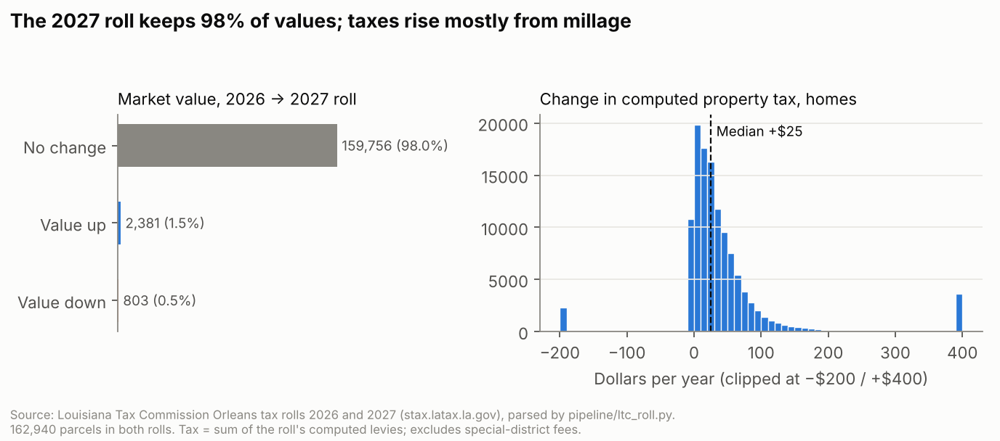

# 2026 vs 2027 Orleans roll comparison

Generated by `pipeline/compare_rolls.py` from the Louisiana Tax Commission downloads (`pipeline/ltc_roll.py`).
Joined on **parcel ID**. Sources: `stax.latax.la.gov/TaxRollsFolder/2025/ORLEANSDISTRICT*_2026_TAXROLL.zip`
(posted Nov. 2025) and `.../2026/ORLEANS*_2027_*_TAXROLL.zip` (posted Sept. 4, 2026).

> **Why 2026 vs 2027 and not 2025 vs 2026:** the assignment asks for 2025 vs 2026, but the LTC site only keeps the two
> most recent upload years, and the course Box folder has only 2026. The 2025 Orleans roll isn't available to download
> there. The newest pair is 2026 vs 2027, the comparison owners need now. The parser was checked first: the 2026
> download reproduces the course's Box file **exactly** (market, land and taxable values match on all 163,135 parcels).

| | 2026 roll | 2027 roll |
|---|---|---|
| Parcels (real estate) | 163,135 | 163,138 |
| In both rolls | 162,940 | |
| Only in one roll (new, split, merged or retired IDs) | 195 | 198 |
| Total market value, all parcels in each roll | $75.65B | $76.78B |
| Total market value, 162,940 parcels in both rolls | $75.54B | $76.55B |
| Total taxable assessed value, parcels in both rolls | $4.69B | $4.78B |
| Total computed net tax (all levies in the file), parcels in both rolls | $625.1M | $643.1M |
| Median total millage, residential parcels | 131.99 | 133.48 |
| Median computed tax, homesteaded homes | $1,965 | $2,032 |
| Valuation date on every parcel | 01/01/2023 | |

**What changed**
- **98.0% of parcels have exactly the same market value** in both rolls. 2,381 went
  up and 803 went down. Among those that changed, the middle half moved between -0.1% and
  +87%.
- Changes are concentrated in parcels that recently sold. The rest are likely construction, demolition or corrections (not checked).
  - 55% of increases are on parcels with a recorded sale in 2025–2027.
  - 183 changed parcels now sit at about 92% of their recent sale price, the
    same reset-on-sale pattern seen in the 2026 sales study.
- **Taxes move mostly because one millage went up** (the East Bank levee district's, 10.79 → 12.28 mills; the
  citywide millages are unchanged at 121.20): the median residential rate rose from
  131.99 to 133.48 mills. The median home's computed
  tax changed by +$25, and 84% of homes see an
  increase.

**What this means for the "2027 reassessment"**
**The 2027 roll is not a reappraisal, and the data shows it.** Values are unchanged for 98% of parcels and the
valuation date is still 01/01/2023. That is what the four-year cycle predicts: the Legislative Auditor's report on the
tax year 2024 reappraisal says property is valued as of "January 1, 2023 for tax years 2024 through 2027" [S15], and
the City Council said the same in July 2023 [S32]. Between reappraisals the Assessor can still update a parcel for a
sale, construction, demolition, deterioration or remodeling [S15], which fits the 2% that changed. The pattern (2020,
2024) points to tax year 2028 for the next reappraisal; that part is an inference, not an announcement.
*(An earlier version of this page said our sources expected a reappraisal on the 2027 roll. Those were secondary
sources and they were wrong.)*

**Limits**
- "Tax" here is the sum of the levies listed in the roll file: parish-wide millages plus the East Bank or Algiers levee
  district. It doesn't include special-district fees (Downtown Development District, security districts), which are
  billed separately, so a real bill can be higher.
- Parcels whose ID changed can't be matched, by design.
